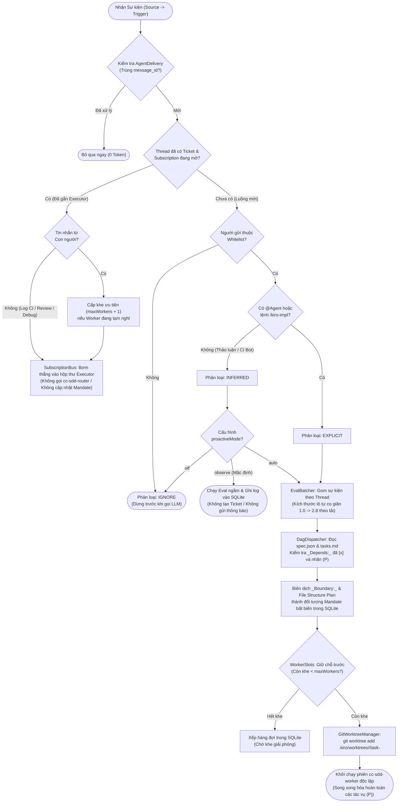
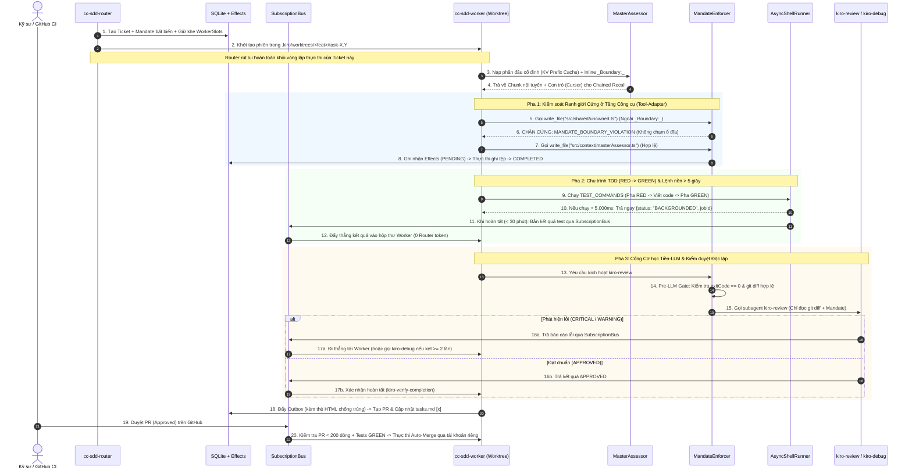
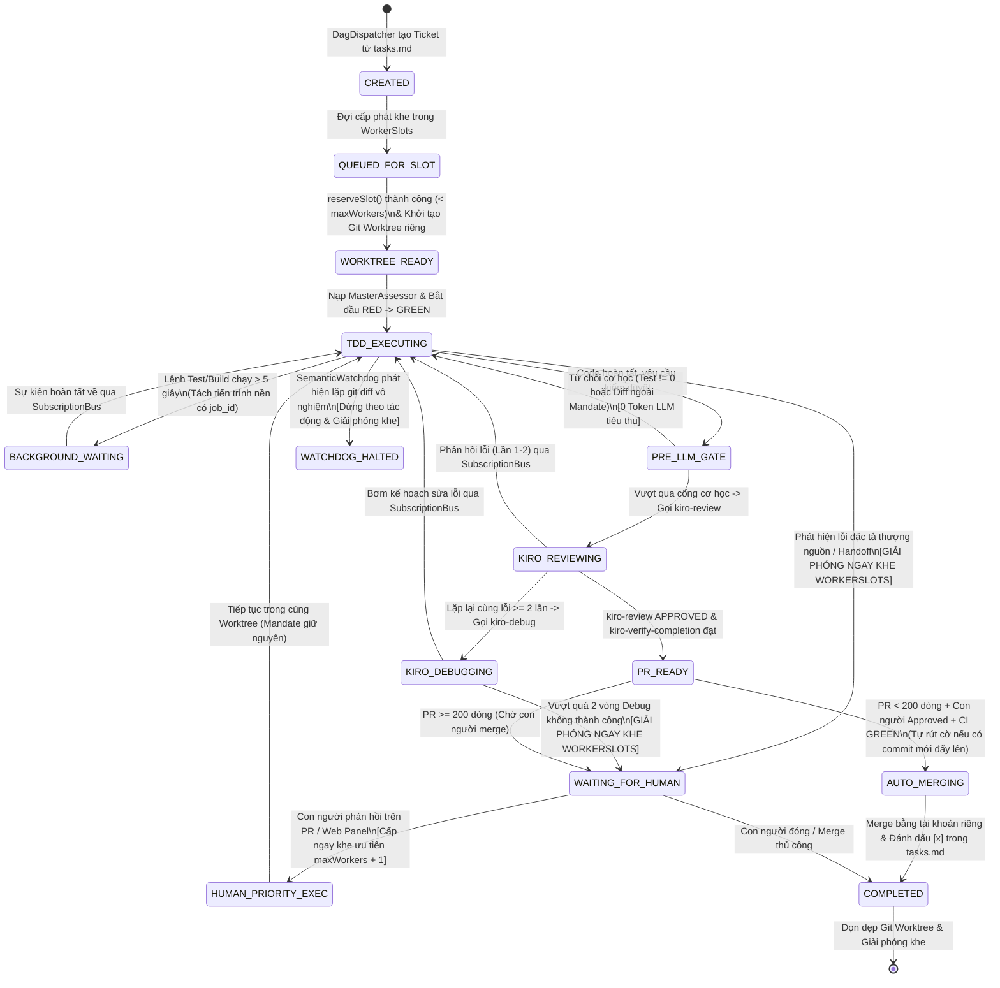
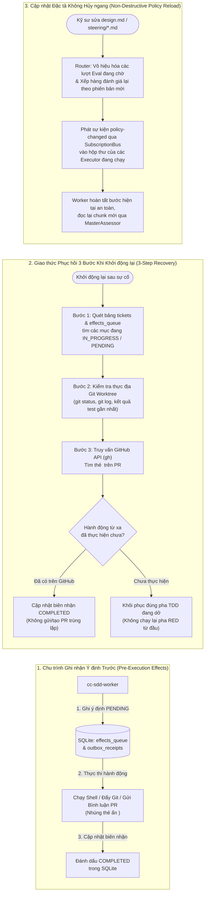

# Sơ đồ Thiết kế Kiến trúc & Quy trình Vận hành `cc-sdd` v4.0 (Super-Harness)

* **Header Metadata (Machine-Oriented Dependencies):**
  * Depends on: `.kiro/specs/cc-sdd-superagent-refactor/requirements.md` (`SPEC-CC-SDD-V4`)
  * Depends on: `.kiro/specs/cc-sdd-superagent-refactor/design.md`
  * Depends on: `.kiro/specs/cc-sdd-superagent-refactor/tasks.md`

Tài liệu này mô hình hóa toàn bộ kiến trúc hệ thống và các luồng thực thi cốt lõi của **cc-sdd v4.0** sau khi hợp nhất kỷ luật **Boundary-First TDD** với kiến trúc điều phối **Router–Worker** của `dsh-superagent-prototype`.

---

## 1. Sơ đồ Kiến trúc Tổng thể 5 Cam kết Ranh giới (5-Boundary System Architecture)

Sơ đồ dưới đây thể hiện sự phân tách vật lý giữa 5 ranh giới mô-đun (`BND-ROUTER-DISCOVERY`, `BND-EXEC-RUNTIME`, `BND-CONTEXT-MANDATE`, `BND-STATE-ENGINE`, và `BND-SUPERVISION-INTEGRATION`), giải quyết triệt để lỗi tác nhân chính tự viết code trong phiên đơn và hiện tượng phình ngữ cảnh $+223\%$ token.

### 1.1. Bản vẽ Cấu trúc Trực quan (ASCII Blueprint)

```text
+===================================================================================================+
|                        NGUỒN SỰ KIỆN & CON NGƯỜI (SOURCES & HUMAN ATTENTION)                      |
|   [IDE /kiro-* CLI]      [GitHub Issues / PR / Reviews / CI]      [Web Panel :3082 (6 Tabs)]      |
+===================================================================================================+
               |                                   |                                   ^
               v (1. Sự kiện mới)                  v (2. Sự kiện trên luồng đã mở)     | (Cảnh báo /
+-------------------------------------+   +----------------------------------------+   |  Can thiệp)
|     BND-ROUTER-DISCOVERY            |   |          BND-CONTEXT-MANDATE           |   |
|  (Preset: cc-sdd-router - No Edit)  |   |                                        |   |
|                                     |   |  +----------------------------------+  |   |
|  [Source -> Trigger -> Thread]      |   |  |        SubscriptionBus           |  |   |
|                 |                   |   |  | (Direct Event Pass-Through:      |  |   |
|                 v                   |   |  |  Bỏ qua Router, -30% Decisions,  |  |   |
|  [AdmissionGate: Whitelist/@Agent]  |   |  |  -37% Cache-Read Tokens)         |  |   |
|   |-- ignore (0 LLM token)          |   |  +----------------------------------+  |   |
|   |-- inferred (off|observe|auto)   |   |  +----------------------------------+  |   |
|   +-- explicit                      |   |  |         MasterAssessor           |  |   |
|                 |                   |   |  | (Inline _Boundary:_ + Chained    |  |   |
|                 v                   |   |  |  Recall qua Stable ID & Cursor)  |  |   |
|  [EvalBatcher (Batch 1.0 -> 2.8)]   |   |  +----------------------------------+  |   |
|                 |                   |   |  +----------------------------------+  |   |
|                 v                   |   |  |         MandateEnforcer          |  |   |
|  [DagDispatcher: Đọc tasks.md]      |   |  | (Chặn cứng Tool-Adapter ngoài    |  |   |
|  (Phân giải _Depends:_ & nhãn (P))  |   |  |  _Boundary:_ + Pre-LLM Gate)     |  |   |
+-------------------------------------+   +----------------------------------------+   |
               |                                   | (Tiêm thẳng vào hộp thư Worker)   |
               v (Cấp phát Ticket + Mandate)       v                                   |
+======================================================================================+============+
|                                     BND-EXEC-RUNTIME                                 |            |
|                                                                                      |            |
|  +--------------------------------------------------------------------------------+  |            |
|  | Bộ lập lịch WorkerSlots: Giữ chỗ trước | Trần maxWorkers | Khe ưu tiên (+1)   |  |            |
|  +--------------------------------------------------------------------------------+  |            |
|          |                               |                               |           |            |
|          v (Worktree 1)                  v (Worktree 2 - Song song (P))  v (Khe +1)  |            |
|  +-------------------------------+  +-------------------------------+  +----------+  |            |
|  | Executor: worker-task-1.1     |  | Executor: worker-task-1.2     |  | Executor |  |            |
|  | (.kiro/worktrees/feat/1.1)    |  | (.kiro/worktrees/feat/1.2)    |  | (Human   |  |            |
|  |  1. TDD: RED -> GREEN         |  |  1. TDD: RED -> GREEN         |  |  Follow  |  |            |
|  |  2. AsyncShell (>5s -> Nền)   |  |  2. AsyncShell (>5s -> Nền)   |  |  -Up)    |  |            |
|  |  3. Pre-LLM Gate -> Review    |  |  3. Pre-LLM Gate -> Review    |  +----------+  |            |
|  +-------------------------------+  +-------------------------------+                |            |
|          |                                                                           |            |
|          v                                                                           |            |
|  [ConditionalAutoMerge: PR < 200 dòng + Human Approved + Tests GREEN + Tài khoản riêng]           |
+======================================================================================+============+
               |                                                       ^               |
               v (Ghi/Đọc trạng thái & Ý định)                         | (Quét độc lập)|
+----------------------------------------------------+   +-----------------------------+------------+
|                  BND-STATE-ENGINE                  |   |       BND-SUPERVISION-INTEGRATION        |
|          (.kiro/state/harness.db - SQLite)         |   |                                          |
|                                                    |   |  [SemanticWatchdog Loop]                 |
|  * Bảng: tickets, mandates, assignments,           |   |  (Phát hiện lặp git diff / kẹt TDD       |
|          subscriptions, context_chunks             |   |   -> Dừng theo mức độ tác động)          |
|  * Effects Queue: Ghi nhận PENDING trước khi chạy  |   |                                          |
|  * Outbox & AgentDelivery: Chống trùng thẻ HTML    |   |  [Multi-Agent Manifests & 17 SKILL.md]   |
|  * 3-Step Recovery: SQLite + Worktree + GitHub API |   |  (8 Coding Agents x 14 Ngôn ngữ)         |
+----------------------------------------------------+   +------------------------------------------+
```

### 1.2. Sơ đồ Kiến trúc Mermaid.js

```mermaid
flowchart TB
    subgraph Sources["Nguồn Sự kiện & Giao diện Con người"]
        CLI["IDE /kiro-* CLI"]
        GH["GitHub Issues / PR / CI / Comments"]
        WP["Web Panel (:3082 - 6 Tabs)"]
    end

    subgraph BND_ROUTER["1. BND-ROUTER-DISCOVERY (cc-sdd-router)"]
        INGEST["Source -> Trigger -> Thread"]
        ADMIT["AdmissionGate\n(Whitelist / @Agent)"]
        BATCH["EvalBatcher\n(Co giãn lô 1.0 -> 2.8)"]
        DAG["DagDispatcher\n(Đọc _Depends:_ & nhãn (P))"]
        INGEST --> ADMIT
        ADMIT -->|explicit / inferred(auto)| BATCH
        BATCH --> DAG
    end

    subgraph BND_CONTEXT["2. BND-CONTEXT-MANDATE"]
        SUB["SubscriptionBus\n(Direct Event Pass-Through)"]
        ASSESSOR["MasterAssessor\n(Inline _Boundary:_ + Chained Recall)"]
        MANDATE["MandateEnforcer\n(Tool-Adapter Firewall & Pre-LLM Gate)"]
    end

    subgraph BND_EXEC["3. BND-EXEC-RUNTIME (cc-sdd-worker)"]
        SLOTS["WorkerSlots\n(Pre-allocation & Khe ưu tiên maxWorkers + 1)"]
        WT1["Executor 1 + Git Worktree 1\n(Task X.1 - TDD RED/GREEN)"]
        WT2["Executor 2 + Git Worktree 2\n(Task X.2 (P) - TDD RED/GREEN)"]
        SHELL["AsyncShellRunner\n(> 5s chuyển nền, timeout 30p)"]
        MERGE["ConditionalAutoMerge\n(PR < 200 LOC + Approved + Bot riêng)"]
        SLOTS --> WT1 & WT2
        WT1 & WT2 --> SHELL
        WT1 & WT2 --> MERGE
    end

    subgraph BND_STATE["4. BND-STATE-ENGINE (.kiro/state/harness.db)"]
        DB[("SQLite State DB\n(tickets, mandates, assignments)")]
        EFFECTS["Effects Queue & Outbox\n(Ý định trước thực thi + Thẻ HTML)"]
        REC["3-Step Crash Recovery\n(SQLite + Worktree + GitHub API)"]
        DB <--> EFFECTS
        REC --> DB
    end

    subgraph BND_SUP["5. BND-SUPERVISION-INTEGRATION"]
        WD["SemanticWatchdog\n(Quét độc lập & Ngắt lặp vô nghiệm)"]
        REG["8-Agent Registry & Templates\n(cc-sdd-router / cc-sdd-worker)"]
    end

    CLI & GH -->|Sự kiện mới| INGEST
    GH -->|Sự kiện trên luồng đã đăng ký| SUB
    SUB -->|Đi thẳng tới Worker, bỏ qua Router| WT1 & WT2
    DAG -->|Khởi tạo Ticket & Mandate| DB
    DAG -->|Yêu cầu cấp khe| SLOTS
    ASSESSOR <-->|Đọc phân trang O(1)| WT1 & WT2
    MANDATE -->|Chặn ghi tệp ngoài phạm vi| WT1 & WT2
    WT1 & WT2 -->|Ghi Effects trước khi gọi tool/PR| EFFECTS
    WD -->|Giám sát tiến triển thực chất| DB
    WD -->|Dừng theo tác động & Báo cáo| WP
    ADMIT -->|inferred (chế độ observe)| DB
```

---

## 2. Quy trình Tiếp nhận Sự kiện, Phân quyền & Điều phối DAG Song song

Quy trình này mô tả cách một sự kiện đi từ `Source` qua bộ lọc tiền-LLM (tiết kiệm tối đa token đối với tin nhắn nhiễu), gom lô động tại `EvalBatcher`, phân rã đồ thị tác vụ `tasks.md` và cấp phát khe chạy song song trên các thư mục `git worktree` riêng biệt.



---

## 3. Biểu đồ Tuần tự (Sequence Diagram): Chu trình TDD của Worker, `SubscriptionBus` & Tường lửa `Mandate`

Biểu đồ tuần tự dưới đây làm rõ cách `cc-sdd-worker` thực hiện chu trình TDD (`RED` $\rightarrow$ `GREEN`), cách `MandateEnforcer` chặn đứng hành vi sửa lẹm tệp ngoài phạm vi, cách các lệnh kiểm thử chạy quá $5\text{s}$ được chuyển xuống nền, và cách toàn bộ vòng lặp `kiro-review` / `kiro-debug` giao tiếp trực tiếp qua `SubscriptionBus` mà không làm tốn token của `cc-sdd-router`.



---

## 4. Sơ đồ Máy Trạng thái (State Diagram): Vòng đời `Ticket` & Quản lý Khe `WorkerSlots`

Sơ đồ này thể hiện vòng đời đầy đủ của một `Ticket` trong bảng `tickets` của SQLite, đặc biệt nhấn mạnh cơ chế **giải phóng khe thực thi ngay khi chờ con người** (`WAITING_FOR_HUMAN`) và **cấp phát khe ưu tiên vượt trần** (`maxWorkers + 1`) khi con người phản hồi.



---

## 5. Sơ đồ Cơ chế Ngữ cảnh `MasterAssessor` & Tối ưu Bộ nhớ Đệm (KV Prefix Cache)

Để loại bỏ mức phạt $+223\%$ token của kỹ năng `kiro-impl` cũ (do nạp đi nạp lại toàn bộ `requirements.md`, `design.md`, `steering/*.md` và ghi nối tiếp vào `## Implementation Notes`), `MasterAssessor` tổ chức lại bộ nhớ theo mô hình **Inline–Spill–Chained Recall** với tiền tố bất biến:

```text
+---------------------------------------------------------------------------------------------------+
|                     CẤU TRÚC NGỮ CẢNH CỦA WORKER (OPTIMIZED KV PREFIX CACHE)                      |
+---------------------------------------------------------------------------------------------------+
| PHẦN 1: TIỀN TỐ BẤT BIẾN (STATIC PREFIX - ĐƯỢC LƯU CACHE 100% GIỮA CÁC LƯỢT GỌI)                  |
|  [1.1] System Prompt & Quy tắc Cốt lõi của cc-sdd-worker (Không chứa biến động thời gian thực)    |
|  [1.2] Đối tượng Mandate Bất biến (Danh sách tệp được phép sửa & Lệnh kiểm thử của Ticket X.Y)    |
|  [1.3] Phần Nội tuyến (Inline Context): Chỉ trích xuất đúng khối _Boundary:_ của Ticket X.Y       |
+---------------------------------------------------------------------------------------------------+
| PHẦN 2: TRUY HỒI CHUỖI CÓ NGÂN SÁCH (SPILL & CHAINED RECALL - ĐỘ PHỨC TẠP O(1) TOKEN)             |
|  Thay vì nạp toàn bộ tài liệu, phần tràn (Spill) được lưu trong bảng SQLite `context_chunks`:     |
|                                                                                                   |
|   +-------------------------------+       readChunk(stableId, cursor, maxChars)                   |
|   | Bảng SQLite `context_chunks`  | <===============================================+             |
|   |  * REQ-SPD-02 (Chunk #01..03) |                                                 |             |
|   |  * BND-EXEC   (Chunk #04..08) | === Trả về đúng trang cần đọc + Cursor tiếp ===>+             |
|   |  * Impl Notes (Chunk #09..15) |     (Giữ nguyên lịch sử phía trước để trúng KV Cache)         |
|   +-------------------------------+                                                               |
+---------------------------------------------------------------------------------------------------+
```

---

## 6. Sơ đồ Giao thức Bền vững `SQLite + Effects + Outbox` & Phục hồi 3 Bước Sau Sự cố

Sơ đồ cuối cùng mô tả cơ chế bảo vệ tính đúng đắn của hệ thống khi xảy ra sự cố sập nguồn đột ngột (`SIGKILL` / mất kết nối mạng) hoặc khi người dùng sửa đổi tệp đặc tả (`design.md`, `steering/*.md`) trong lúc các Worker đang chạy.

